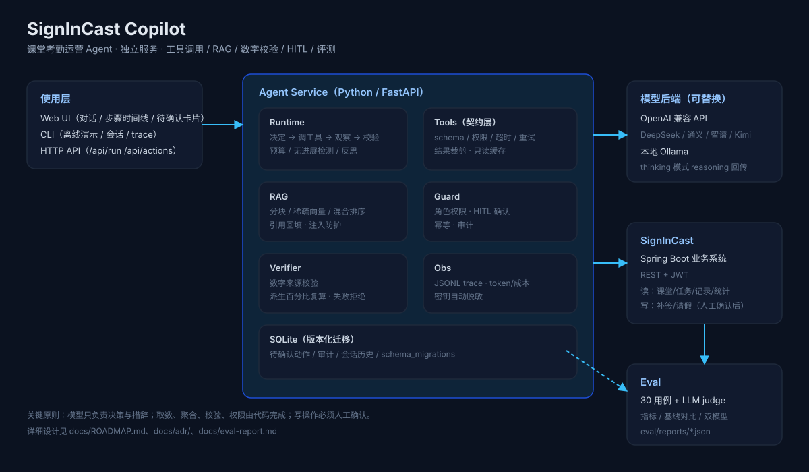

# SignInCast Copilot

**接在已有课堂签到系统上的 Agent 服务**：把"查考勤、判异常、出清单、导报告"这类跨页面、跨接口的多步任务，变成一句话完成；结论带依据、数字可溯源、写操作必须人工确认。

[](#)
[](#质量门禁)
[](#)
[](#)



## 它是什么 / 不是什么

| 是 | 不是 |
| --- | --- |
| 一个独立的 Python Agent 服务，通过 REST + JWT 接入 SignInCast | 不是把 AI 塞进 Java 业务代码里 |
| 真实模型决策 + 工具调用 + RAG 引用 + 数字校验 + HITL 写操作 | 不是只能聊天的问答框 |
| 有 30 条真实模型评测、双模型对比、成本与延迟数据 | 不是"效果很好"的口号 |
| 可离线演示（mock 数据 + fake 模型）、可私有化部署 | 不是依赖公网的多租户 SaaS |

## 当前状态

| 里程碑 | 状态 |
| --- | --- |
| M0 骨架（运行时 / 工具契约 / HITL / trace） | ✅ |
| M1 真实联调（登录 + 录制 12 个真实响应，已脱敏） | ✅ |
| M2 工程化（RAG 引用 / 数字校验 / 学生权限 / 报告 / Web UI / 会话持久化） | ✅ |
| M3 评测降本（30 条真实模型用例 + judge + 双模型对比 + 基线） | ✅ |
| M4 交付（Docker / 部署文档 / 演示脚本 / README） | 🚧 进行中（Docker 未在本机构建验证；录像待作者） |

## 评测结果（真实模型，详见 [eval-report](docs/eval-report.md)）

| 指标 | 基线（deepseek-chat） | 优化配置 | deepseek-flash（10 条） | deepseek-v4-pro（10 条） |
| --- | --- | --- | --- | --- |
| 完成率 | 93.3% | **100%** | 100% | 100% |
| Judge 通过率 / 均分 | 82.1% / 4.5 | 86.7% / 4.6 | 90% / 4.6 | 80% / 4.5 |
| 工具精确率 / 召回率 | 0.40 / 0.80 | 0.40 / 0.83 | 0.48 / 0.90 | 0.45 / 0.80 |
| P95 延迟 | 6.3 s | 6.1 s | 12.0 s | 25.2 s |
| 单用例成本 | $0.0044 | $0.0046 | $0.0068 | $0.0062 |
| 禁用工具调用 | 0 | 0 | 0 | 0 |

> 数据来自 30 条用例 × 1 轮 + 10 条子集 × 2 模型；单轮评测有随机性，结论看趋势。
> 一个诚实的负结果：`rag_top_k 5→3` + 工具缓存**没有降低 token 成本**（+5%），默认配置保持质量优先；
> 详见报告与 [ADR-008](docs/adr/008-dual-backend-and-cost.md)。

## 核心能力

| 能力 | 说明 |
| --- | --- |
| Agent 主循环 | 决定 → 工具 → 观察 → 校验 → 终止；步数/token/时间预算；无进展检测；失败反思 |
| 工具契约 | pydantic 入参校验、角色权限、超时、只读重试、写操作不重试、结果裁剪 |
| 真实业务工具 | 课堂 / 名单 / 任务 / 签到记录 / 学期统计；学生只读本人（`get_my_*`） |
| RAG | 分块 + TF-IDF 稀疏向量 + 关键词混合排序；引用回填；注入防护；检索失败降级 |
| 数字校验 | 回答中的数字必须来自工具结果；派生百分比可复算；不通过则重试后拒绝 |
| HITL | 模型只能提议；人工确认令牌；执行器幂等 + 审计；mock 模式明确拒绝写 |
| 报告导出 | 单次任务 / 整学期汇总，Markdown 或 Excel |
| 可观测 | JSONL trace（脱敏）+ token/成本；文本与 HTML 查看器 |
| 会话 | SQLite 版本化迁移；`session_id` 多轮；待确认动作与审计持久化 |
| 评测 | 30 条用例 + LLM judge + 基线对比 + 双模型（`make model-eval`） |

## 快速开始

```bash
git clone <repo> && cd SignInCast-Copilot
python3 -m venv .venv
.venv/bin/pip install -e ".[dev]"

# 1) 离线演示（mock 数据 + fake 模型，不需要任何 Key）
make run

# 2) Web UI（对话 / 步骤时间线 / 待确认卡片）
make api            # 打开 http://127.0.0.1:8000/

# 3) 一键验收（测试 + 静态检查 + 回放评测）
make verify         # 108 passed / ruff / 10-10
# 或分开：make test / make lint / make eval

# 4) 评测与回归
make eval           # 回放评测（离线）
make model-eval     # 真实模型评测（需要 .env 配置 Key）

# 5) 接入真实系统（只读）
make smoke          # 真实登录 + 契约校验（只打印安全信息）
make record         # 录制 + 脱敏 + 重新生成用例
```

### 接真实模型 / 真实账号

```bash
cp .env.example .env
# 模型（二选一）
COPILOT_LLM_PROVIDER=openai_compat
COPILOT_LLM_BASE_URL=https://api.deepseek.com/v1
COPILOT_LLM_API_KEY=sk-...
COPILOT_LLM_MODEL=deepseek-chat
# SignInCast 教师账号（live/record 需要）
COPILOT_SIGNINCAST_USERNAME=...
COPILOT_SIGNINCAST_PASSWORD=...
```

### Docker

```bash
docker compose build
docker compose up -d
curl -s localhost:8000/health
```

> 已在本机验证（Docker Desktop aarch64 / Compose v5.7）：镜像构建、健康检查、Web UI、容器内 CLI、真实模型调用均通过（2026-11-18）。

## 演示

- 3 分钟演示脚本 / 分镜 / 预期输出：[docs/DEMO.md](docs/DEMO.md)
- 现场演示：`make api` → `http://127.0.0.1:8000/`
- HITL 离线演示：`make demo-hitl`

## 设计取舍

- **独立服务而非塞进 Java 工程**：AI 服务迭代快、依赖重；通过 API 集成是企业的真实形态。[ADR-001](docs/adr/001-service-boundary.md)
- **自研轻量运行时而非直接用编排框架**：预算、HITL、trace 需要精确插入；模型通过 `ChatModel` 协议隔离。[ADR-002](docs/adr/002-runtime-and-llm-abstraction.md)
- **写操作必须人工确认**：Agent 的事故不是"答错"而是"做错"；令牌只走人工通道。[ADR-003](docs/adr/003-human-in-the-loop.md)
- **接现成模型、不训练**：缺的是数据接入与可靠性，不是模型知识；训练不在范围内。[ADR-004](docs/adr/004-model-strategy.md)
- **mock/record/live 三态传输**：离线可测、录制可回放、契约漂移测试先红。[ADR-005](docs/adr/005-transport-modes.md)
- **HITL 持久化与执行器分离**：跨重启不丢、审计可查、失败可重试。[ADR-006](docs/adr/006-hitl-execution.md)
- **TF-IDF 混合检索而非神经 embedding**：离线、确定性、零下载；`Retriever` 协议保留换后端空间。[ADR-007](docs/adr/007-rag-selection.md)
- **双模型对比与降本要度量**：用数据选模型；降本按 token 构成做，负结果照实写。[ADR-008](docs/adr/008-dual-backend-and-cost.md)

## 项目结构

```
app/
  business/    SignInCast 客户端、传输（live/record/mock）、模型契约、报告、脱敏
  runtime/     主循环、上下文压缩、验证器、反思、缓存
  tools/       工具契约与注册表、业务工具、学生工具、报告工具、HITL 提议
  guard/       权限、HITL、执行器
  rag/         分块、检索
  storage/     SQLite（迁移 / 动作 / 会话）
  obs/         trace 与成本
  web/         Web UI（原生 HTML/JS/CSS）
  main.py      FastAPI 入口
  cli.py       命令行入口
data/
  runbook/     知识库语料
  fixtures/    http（真实录制，已脱敏）/ http-sample（合成样例）
eval/          用例、回放、真实模型评测、报告
docs/          路线、工程准则、ADR、部署、演示、局限、评测报告
tests/         108 个测试（单元 / 集成 / 契约 / 回放）
```

## 质量门禁

- `make test`：108 passed
- `make lint`：ruff 全绿（app / tests / eval / scripts）
- `make eval`：回放评测 10/10
- 契约测试：线上响应结构漂移时测试先红
- 每次改动跑基线对比（`--baseline`）发现退步

## 已知局限

见 [docs/limitations.md](docs/limitations.md)：数据量小、RAG 非神经 embedding、judge 自评偏差、接口无鉴权、写操作未在线上验证等，均已明确记录。

## 文档

| 文档 | 内容 |
| --- | --- |
| [ROADMAP](docs/ROADMAP.md) | 路线与里程碑、验收标准、风险 |
| [ENGINEERING](docs/ENGINEERING.md) | 健壮性/可读性/可维护性硬约束、提交规范、自检清单 |
| [DEPLOYMENT](docs/DEPLOYMENT.md) | 本地/Docker/内网部署、配置、备份、安全、排障 |
| [TESTING](docs/TESTING.md) | 从零到验收的完整测试手册（离线 / 真实 / Docker） |
| [DEMO](docs/DEMO.md) | 3 分钟演示脚本与分镜 |
| [eval-report](docs/eval-report.md) | 回放评测 + 真实模型评测 + 双模型 + 成本 |
| [limitations](docs/limitations.md) | 已知局限（30 条） |
| [adr/](docs/adr/) | 8 篇架构决策记录 |

## License

TBD（公开前补充）。
